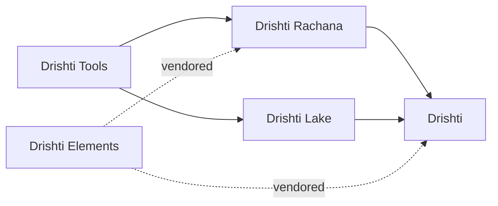

<!-- Copyright (c) 2026 Ashutosh Sinha <ajsinha@gmail.com>. All rights reserved. Drishti platform. Proprietary: see LICENSE. -->

<p align="center"></p>

<h1 align="center">The Drishti platform</h1>

<p align="center"><b>Any data. Any domain. One grammar.</b><br>
<i>Your data is a treasury;</i> <b>Drishti is its sentinel.</b></p>

<p align="center">
  <a href="COMPATIBILITY.md"></a>
  
  
  
  
</p>

**The real-time risk and analytics layer that sits next to a bank's trading systems.** Drishti loads trade-grain data from the
systems a bank already runs, aggregates it on demand for any scope, from the whole bank to an ad-hoc set of trades, and explains every
figure: where it came from, how it was calculated and why it moved. It is not an order or execution system, and it never prices: it
shows what its sources supply and says exactly what is missing.

The platform is **five products, each useful on its own**, released separately and built in one order. This repository is their
index: what each one is, which versions go together, and the scripts that fetch and build them all. No product code lives here.

> **Getting the code.** GitHub's green **Code → Download ZIP** on this page gives **only this index** (the scripts and this
> README), not the products. For **everything in one download**, open **[Releases](https://github.com/drishti-platform/drishti-platform/releases)**
> and download **`drishti-platform-<release>-source.zip`**: every product's source at its release tag, plus `build_all.py` and checksums.
> Unzip it and run `python build_all.py --bundle .` (needs JDK 21 and Python 3.10+, nothing else). With git installed you can instead run
> `python clone_all.py --release <release>` from this index.

## The products

<table>
<tr>
<td width="200" align="center"></td>
<td><b><a href="https://github.com/drishti-platform/drishti">Drishti</a></b>: <b>any data, any domain, one grammar.</b> The server, the
console and the modules: connectors and lakes, the cluster, screens written as Sutras, the pivot and BI engines, VaR, ES, exposure and
the pre-deal check, roles, masks, four eyes and an audit trail.</td>
</tr>
<tr>
<td align="center"><picture><source media="(prefers-color-scheme: dark)" srcset="brand/drishti_rachana-logo.svg"></picture></td>
<td><b><a href="https://github.com/drishti-platform/drishti-rachana">Drishti Rachana</a></b>: <b>describe a screen, supply the data, get a fast,
professional UI.</b> <i>Screens become assembly, not writing.</i> The Sutra language, its compiler (Java, JavaScript, Python),
fragment libraries, live tables, the Data Protocol, a standalone server and Studio.</td>
</tr>
<tr>
<td align="center"><picture><source media="(prefers-color-scheme: dark)" srcset="brand/drishti_elements-logo-light.svg"></picture></td>
<td><b><a href="https://github.com/drishti-platform/drishti-elements">Drishti Elements</a></b>: plain JavaScript libraries for data-heavy
screens: a grid with a pivot, charts and maps, inputs and forms, live updates and the painter that draws a Sutra. No framework, strict
CSP, vendored, never from a CDN.</td>
</tr>
<tr>
<td align="center"><picture><source media="(prefers-color-scheme: dark)" srcset="brand/drishti_lake-logo.svg"></picture></td>
<td><b><a href="https://github.com/drishti-platform/drishti-lake">Drishti Lake</a></b>: <b>One lake. Every store.</b> Delta, Iceberg and plain files, loaded
and read as one lake. One storage API proven feature-identical across stores (local, memory, S3), one loader in Java and Python with
guards, <code>lake maintain</code>, data contracts, fully Databricks Delta compliant.</td>
</tr>
<tr>
<td align="center"><picture><source media="(prefers-color-scheme: dark)" srcset="brand/drishti_tools-logo.svg"></picture></td>
<td><b><a href="https://github.com/drishti-platform/drishti-tools">Drishti Tools</a></b>: <b>Fix it once. Use it everywhere.</b> Shared, domain-free
Java utilities for the Drishti family. Settings, networking, concurrency, time, one xlsx writer, codecs, CSV, files, a test kit and a BOM, so every
product fixes a bug in one place.</td>
</tr>
</table>

## How they fit



Rachana and Lake build on Tools; Drishti builds on Rachana and Lake and vendors Elements' bundles (Elements has no Java build). The
versions that belong together are in [COMPATIBILITY.md](COMPATIBILITY.md); the machine-readable source is
[platform.yaml](platform.yaml).

## Principles

- **Lean and streamlined:** one implementation of each job, one grammar for every expression, one storage API, one set of screen
  libraries.
- **Accuracy first:** every risk number is computed on the server and proven by goldens on every change.
- **Standards, not workarounds:** data stays 100% Delta and Iceberg compliant, read and written through the official libraries.
- **Plain to run:** Java 21 and Python only, on Windows, Linux and macOS; nothing to install from a CDN, no native executables.

## Install order

Tools, then Rachana, then Lake, then Drishti. Each library repository installs its jars into the Maven repository (`~/.m2`) from its
release tag, and the next one finds them there. `build_all.py` does exactly this.

## Local layout

All repositories sit side by side in one parent folder:

```
~/IdeaProjects/drishti-platform/            (Windows: C:\Users\<you>\IdeaProjects\drishti-platform\)
    drishti-tools/  drishti-rachana/  drishti-lake/  drishti-elements/  drishti/  drishti-platform/ (this index)
```

## Get and build (Python 3.10+, JDK 21; no bash, no .exe)

```
python clone_all.py --release i7b            # clone or update every repository at the release's tags (or --develop)
python build_all.py --release i7b            # build and install in order, then build Drishti
python build_all.py --release i7b --repo-local --skip-tests   # dedicated Maven repository (<parent>/.m2-drishti), no tests
```

`--parent <folder>` changes the parent folder (default: the folder above this repository). Each library is built with its own
`mvnw` / `mvnw.cmd`.

## Source bundle

`python make_bundle.py --release i7b` writes `drishti-platform-i7b-source.zip`: every repository's source at its tag (`git archive`),
this README, `build_all.py` and `SHA-256SUMS`. Unzip, run `python build_all.py --bundle .`, done; it needs no network except Maven
Central.

## Tests

`uv run --with pytest pytest tests` (the logic of the scripts, against a fake repository set).

## Build and run in the IDE

IntelliJ and PyCharm: open the repository root; the launchers are in `run-configs/` (names start with `Platform:`). VS Code: File,
Open Workspace from File, `drishti-platform.code-workspace`.

## Links

Organisation: https://github.com/drishti-platform. Licence: [LICENSE](LICENSE); proprietary, all rights reserved.
