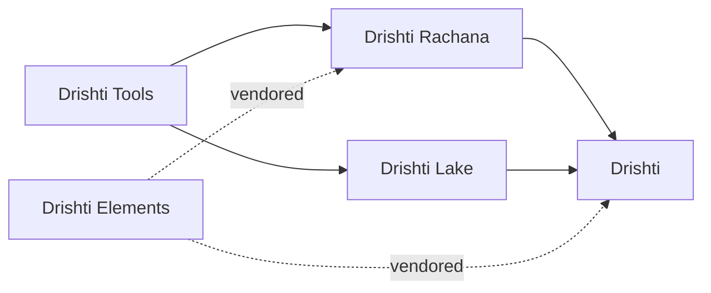

<!-- Copyright (c) 2026 Ashutosh Sinha <ajsinha@gmail.com>. All rights reserved. Drishti platform. Proprietary: see LICENSE. -->

<p align="center"></p>

<h1 align="center">The Drishti platform</h1>

<p align="center"><b>Any data. Any domain. One grammar.</b><br>
<i>Your data is a treasury;</i> <b>Drishti is its sentinel.</b></p>

<p align="center">
  <a href="COMPATIBILITY.md"></a>
  
  
  
  
</p>

**The real-time risk and analytics layer that sits next to a bank's trading systems.** Drishti loads trade-grain data from the
systems a bank already runs, aggregates it on demand for any scope, from the whole bank to an ad-hoc set of trades, and explains every
figure: where it came from, how it was calculated and why it moved. It is not an order or execution system, and it never prices: it
shows what its sources supply and says exactly what is missing.

The platform is **five products, each useful on its own**, released separately and built in one order. This repository is their
index: what each one is, which versions go together, and the scripts that fetch and build them all. No product code lives here.

> **Getting the code.** GitHub's green **Code → Download ZIP** on this page gives **only this index** (the scripts and this
> README), not the products. For **everything in one download**, open **[Releases](https://github.com/drishti-platform/drishti-platform/releases)**
> and download **`drishti-platform-<release>-source.zip`**: every product's source at its release tag, the platform `pom.xml` and its IntelliJ launchers (`run-configs/`), Drishti's pinned Lake Python wheel already in `drishti/lib/wheels/`, `build_all.py` and checksums.
> Then follow **`START_HERE_WINDOWS.pdf`** (or `_LINUX`, `_MACOS`) at the top of the zip. With git installed you can instead run
> `python clone_all.py --release <release>` from this index.

## The products

<table>
<tr>
<td width="200" align="center"></td>
<td><b><a href="https://github.com/drishti-platform/drishti">Drishti</a></b>: <b>any data, any domain, one grammar.</b> The server, the
console and the modules: connectors and lakes, the cluster, screens written as Sutras, the pivot and BI engines, VaR, ES, exposure and
the pre-deal check, roles, masks, four eyes and an audit trail.</td>
</tr>
<tr>
<td align="center"><picture><source media="(prefers-color-scheme: dark)" srcset="brand/drishti_rachana-logo.svg"></picture></td>
<td><b><a href="https://github.com/drishti-platform/drishti-rachana">Drishti Rachana</a></b>: <b>describe a screen, supply the data, get a fast,
professional UI.</b> <i>Screens become assembly, not writing.</i> The Sutra language, its compiler (Java, JavaScript, Python),
fragment libraries, live tables, the Data Protocol, a standalone server and Studio.</td>
</tr>
<tr>
<td align="center"><picture><source media="(prefers-color-scheme: dark)" srcset="brand/drishti_elements-logo-light.svg"></picture></td>
<td><b><a href="https://github.com/drishti-platform/drishti-elements">Drishti Elements</a></b>: plain JavaScript libraries for data-heavy
screens: a grid with a pivot, charts and maps, inputs and forms, live updates and the painter that draws a Sutra. No framework, strict
CSP, vendored, never from a CDN.</td>
</tr>
<tr>
<td align="center"><picture><source media="(prefers-color-scheme: dark)" srcset="brand/drishti_lake-logo.svg"></picture></td>
<td><b><a href="https://github.com/drishti-platform/drishti-lake">Drishti Lake</a></b>: <b>One lake. Every store.</b> Delta, Iceberg and plain files, loaded
and read as one lake. One storage API proven feature-identical across stores (local, memory, S3), one loader in Java and Python with
guards, <code>lake maintain</code>, data contracts, fully Databricks Delta compliant.</td>
</tr>
<tr>
<td align="center"><picture><source media="(prefers-color-scheme: dark)" srcset="brand/drishti_tools-logo.svg"></picture></td>
<td><b><a href="https://github.com/drishti-platform/drishti-tools">Drishti Tools</a></b>: <b>Fix it once. Use it everywhere.</b> Shared, domain-free
Java utilities for the Drishti family. Settings, networking, concurrency, time, one xlsx writer, codecs, CSV, files, a test kit and a BOM, so every
product fixes a bug in one place.</td>
</tr>
</table>

## How they fit



Rachana and Lake build on Tools; Drishti builds on Rachana and Lake and vendors Elements' bundles (Elements has no Java build). The
versions that belong together are in [COMPATIBILITY.md](COMPATIBILITY.md); the machine-readable source is
[platform.yaml](platform.yaml).

## Principles

- **Lean and streamlined:** one implementation of each job, one grammar for every expression, one storage API, one set of screen
  libraries.
- **Accuracy first:** every risk number is computed on the server and proven by goldens on every change.
- **Standards, not workarounds:** data stays 100% Delta and Iceberg compliant, read and written through the official libraries.
- **Plain to run:** Java 21 and Python only, on Windows, Linux and macOS; nothing to install from a CDN, no native executables.

## Quick start (Windows; Linux and macOS: `python3.13` and `/`)

Download two files from the newest [release](https://github.com/drishti-platform/drishti-platform/releases): the source zip and the
wheel pack for your computer. Unzip the source into `drishti-platform\` and the wheels into `%USERPROFILE%\drishti-wheels\`, then:

```
cd drishti-platform
py -3.13 build_all.py --skip-tests                                   # tools, Rachana, Lake, Drishti, in order
cd drishti\drishti-console
py -3.13 -m pip install --no-index --find-links "%USERPROFILE%\drishti-wheels" -r requirements.txt
py -3.13 -m pip install --no-index --find-links "%USERPROFILE%\drishti-wheels" -r ..\config\compute\locks\python.lock
cd ..
py -3.13 tools\drishti.py setup                                      # checks only; ends "Drishti is ready."
py -3.13 tools\drishti.py lake demo --engine java                    # the demo lakes, once
py -3.13 tools\drishti.py start all --demo                           # server and console
py -3.13 tools\drishti.py doctor --acceptance                        # PASS: VaR 167,372,692, ES 210,131,972
```

Open `http://localhost:17480` (sign in `drishti-dev-admin` / `drishti-dev-admin123`). Drishti never creates a Python environment and
never installs packages: the two pip lines are yours, into the Python you choose (use one just for Drishti if other work shares it).
The same steps in IntelliJ IDEA and PyCharm, with what you should see at each step: `START_HERE_*.pdf` and [IDE_GUIDE.md](IDE_GUIDE.md).
Running Drishti for real users (Linux): `drishti/docs/PRODUCTION_DEPLOYMENT.md`.

## IDE launchers

Every launcher sits in a visible `run-configs/` folder, in a group named **IDE-part-purpose**:

| Group | Where | What |
|---|---|---|
| **IntelliJ-platform-build** | `drishti-platform` (IntelliJ IDEA) | `platform-clean-install`: the same build as `build_all.py` |
| **IntelliJ-drishti-build / -run / -test** | `drishti` (IntelliJ IDEA) | build Drishti, run the server (demo, QA, samples), tests |
| **PyCharm-console-setup / -data / -run / -check** | `drishti/drishti-console` (PyCharm) | setup, demo lakes and loading, the console, acceptance |
| **IntelliJ- / PyCharm-tools, -rachana, -lake, -elements-…** | each product's folder | that product's build, run, test, check, install |

From a terminal, `py -3.13 tools\drishti.py launchers --list` shows Drishti's launchers with their exact commands and
`launchers --run "<name>"` runs one.

## Install order and layout

Tools, then Rachana, then Lake, then Drishti: each installs its jars into the Maven repository (`~/.m2`) and the next one finds them
there. All repositories sit side by side in one parent folder:

```
~/IdeaProjects/drishti-platform/            (Windows: C:\Users\<you>\IdeaProjects\drishti-platform\)
    pom.xml  build_all.py  run-configs/  START_HERE_*.pdf  IDE_GUIDE.md
    drishti-tools/  drishti-rachana/  drishti-lake/  drishti-elements/  drishti/
```

## The scripts in this repository

Standard library only (Python 3.10 or later runs them); no bash, no `.exe`.

| Script | Does |
|---|---|
| `clone_all.py --release <name>` | clones or updates every repository at that release's tags (`--develop` for the develop branches), places `pom.xml`, `run-configs/`, the guides |
| `build_all.py [--skip-tests] [--repo-local]` | builds and installs in order (from an unzipped source zip with no option); on Windows trusts the Windows certificate store; Maven gets a space-free temporary folder |
| `make_bundle.py --release <name>` | the source zip: every repository at its tag, the top files and checksums (no `.git`, no IDE folders) |
| `make_wheels.py --release <name> --target <os>` | the offline wheel pack: every wheel the console and the server's Python work need on that system, Python 3.13 |
| `make_start_here.py [--check]` | writes the three START_HERE pages from one template |

`pom.xml` is the same build for Maven and IntelliJ (`mvn -DskipTests` in the parent folder). Tests: `python3 -m pytest tests`.
VS Code: open `drishti-platform.code-workspace`.

## Links

Organisation: https://github.com/drishti-platform. Versions that go together: [COMPATIBILITY.md](COMPATIBILITY.md). Licence:
[LICENSE](LICENSE); proprietary, all rights reserved.
